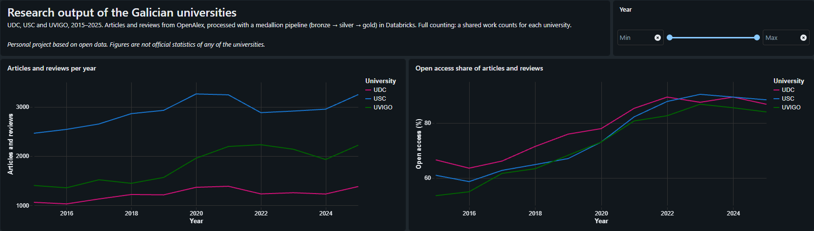
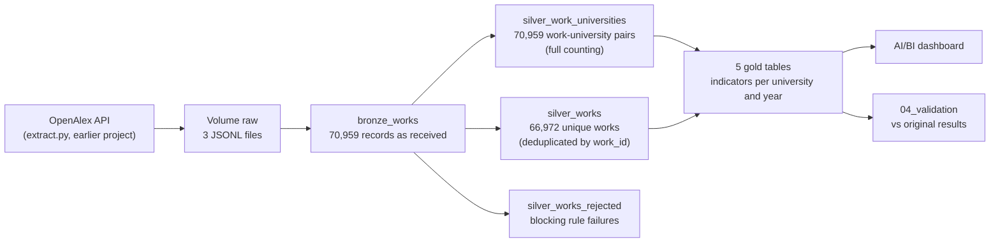
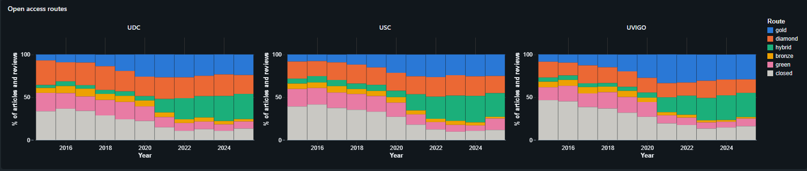
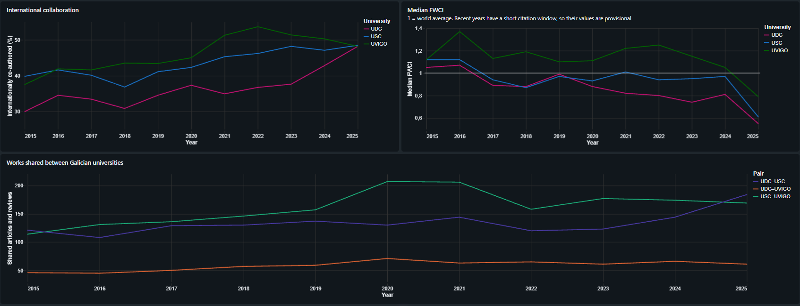

# OpenAlex medallion pipeline in Databricks

**All five gold tables reproduce the results of the original project exactly (165 of 165 rows)**, and a validation notebook fails if they ever stop doing so.

A bronze → silver → gold pipeline in Databricks (PySpark, Spark SQL and Delta Lake) for the research output of the three public universities of Galicia (Spain): Universidade da Coruña (UDC), Universidade de Santiago de Compostela (USC) and Universidade de Vigo (UVIGO), 2015–2025. It rebuilds the analysis of my earlier project, [openalex-galician-universities](https://github.com/BorjaLafuente/openalex-galician-universities) (pandas + SQLite), on Databricks, with explicit data quality rules, incremental loads and an AI/BI dashboard.

> Personal project based on open data. Figures are not official statistics of any of the universities.



## Highlights

- **Medallion architecture** on Unity Catalog: raw API exports in bronze, typed and deduplicated tables in silver, indicator tables in gold.
- **Data quality as code**: blocking rules send works to a rejection table, warning rules keep the work and record each issue by name. Completeness and uniqueness are measured on the saved tables.
- **Incremental loads**: silver tables are written with `MERGE` and a row hash, so only changed works are updated on subsequent runs. Re-running the whole pipeline updates 0 rows.
- **Reproducible validation**: `04_validation` compares every gold table with the original project's results using `EXCEPT` in both directions (rows missing on either side are caught, not just different row counts) and stops with `assert_true` if any row differs.
- **Findings about the source**, not just about the universities: duplicated OpenAlex records, an unreliable `language` field and LaTeX in titles (see [Data quality](#data-quality)).

## Architecture



| Layer | Tables | Content |
|---|---|---|
| Bronze | `bronze_works` | The JSONL records as returned by the API, nested structs included, plus `_source_file` and `_ingested_at` for traceability. The university is only known from the source file name. |
| Silver | `silver_works`, `silver_work_universities`, `silver_works_rejected` | Flattened and typed columns, one row per work (deduplicated by `work_id`), the work-university link table (full counting), quality flags and rejections. |
| Gold | `gold_output_by_year`, `gold_open_access`, `gold_international_collaboration`, `gold_citation_impact`, `gold_galician_collaboration` | One table per indicator, per university and year. |

All tables are managed Delta tables in `workspace.openalex`, with a table comment and column comments.

## Notebooks

| Notebook | What it does |
|---|---|
| [`00_setup`](notebooks/00_setup.ipynb) | Creates the schema and the `raw` and `reference` volumes (idempotent). |
| [`01_bronze`](notebooks/01_bronze.ipynb) | Reads the JSONL files with schema inference, adds the source file (from the hidden `_metadata` column) and the load time, and writes `bronze_works`. |
| [`02_silver`](notebooks/02_silver.ipynb) | Builds the link table, flattens and types the works, deduplicates them, applies the quality rules and loads the silver tables with `MERGE`. Ends with a completeness and uniqueness summary. |
| [`03_gold`](notebooks/03_gold.ipynb) | Builds the five indicator tables with `CREATE OR REPLACE TABLE … AS SELECT` (gold is fully recomputed on each run). |
| [`04_validation`](notebooks/04_validation.ipynb) | Compares the gold tables with the original project's results and fails if they differ. |

## Data quality

### Rules

Rules are defined as dictionaries of named conditions, so each issue is recorded by name. Rule counts are computed when silver is built; completeness and DOI uniqueness are measured on the saved `silver_works` table, so they describe what was actually stored.

| Type | Rules | Treatment |
|---|---|---|
| Blocking (a null value fails the rule) | valid `work_id`, year within 2015–2025, document type in the analysed list | The work goes to `silver_works_rejected` with the reasons |
| Warning, validity | DOI format, language code format, known open access status, non-negative citations and FWCI, markup in titles | The work is kept; the rule name is added to `dq_issues` |
| Warning, consistency | `is_oa` agrees with `oa_status`, top 1% implies top 10%, at least one country, no fewer institutions than countries | Same |
| Warning, uniqueness | the same DOI under several OpenAlex IDs (computed with a window function) | Same |

### Results

| Check | Result |
|---|---|
| Records vs unique works | 70,959 records, 66,972 works. All 3,987 extra records are works shared between universities; no work is repeated within a university file. |
| Copies of a shared work | Identical in every column (asserted before deduplicating). |
| Blocking rules | 0 rejected works (the API query already filtered year and type). |
| `title_has_markup` | 295 works (titles with LaTeX or MathML, mostly physics and mathematics). Kept as they are: removing the markup would leave the formulas unreadable. |
| `duplicate_doi` | 214 works = 107 DOIs, each under two OpenAlex IDs. |
| `fewer_institutions_than_countries`, `no_countries` | 3 and 2 works: authors with a country but no matched institution, or an institution without a country in OpenAlex. |
| Completeness | Fully populated: IDs, year, type, title, open access, citations and collaboration counts. Missing: publisher 13.9%, ISSN-L 11.1%, source 5.2%, DOI 5.0%, language 0.8%, topic and FWCI 0.1%. |

### Findings worth knowing

- **Duplicated records in OpenAlex.** The 107 repeated DOIs are the same article stored twice, typically the journal version and a copy in a repository or arXiv. The two records split the citations (in one example, 6 and 22 citations for the same article) and can disagree on the open access route. Silver flags both records instead of guessing which one is right; the gold tables keep the definition of the original project, which counts both, so that the results stay comparable with it (at most 107 works, 0.16% of the total). Counting by DOI is a defensible alternative and is listed below as a possible extension.
- **The `language` field is unreliable.** It is detected automatically: 478 works are labelled Latvian, and a sample shows they are English particle physics papers whose titles are full of symbols. A bilingual title was labelled Lojban. The values are kept as received, documented in the column comment and not used in any indicator.
- **No topic, no FWCI.** In this extraction, all 88 works without a subject classification also lack FWCI and top-percentile flags, and no other work does, consistent with these indicators being normalised by field.
- **A first version of a rule can be too narrow.** The markup rule first found 1 title (HTML only); after inspecting the data it was extended to LaTeX and found 295. Each rule was checked in both directions: that it can fire (a positive control on test data) and that what it flags is really a problem (a sample of flagged rows).

## Design decisions

- **Bronze keeps the inferred schema**; silver defines every type explicitly in a `CREATE TABLE` with `NOT NULL` where a blocking rule guarantees it. The table definition is the contract: a write that does not fit fails.
- **Works are deduplicated after building the link table**, because the university is only known per bronze record.
- **Silver is loaded with `MERGE`.** A SHA-256 hash of each row (`_row_hash`), computed over all the columns of the work in silver including its quality flags, decides which works changed. Load metadata such as `_ingested_at` stays in bronze, so reloading bronze does not trigger updates: a full re-run after rewriting bronze updated 0 rows. The Delta history shows exactly what each load changed, and a test that altered one row in the table was corrected by the next run.
- **Rejections are a snapshot**: `silver_works_rejected` is overwritten on each run and keeps its schema.
- **Gold is recomputed** with `CREATE OR REPLACE TABLE … AS SELECT`. Gold tables hold aggregated results rather than individual records (one changed work alters the totals of its group), so a full recomputation is simpler and more reliable than incremental updates at this scale.
- **One schema with layer prefixes** (`bronze_`, `silver_`, `gold_`) instead of one schema per layer, which suits a project of this size.
- **Technical columns start with an underscore** (`_source_file`, `_ingested_at`, `_row_hash`); quality columns do not, because they are meant for users of the tables.

## Validation

`04_validation` reads the original results (`results/*.csv` of the earlier project, uploaded to the `reference` volume) with `read_files` and compares them with the gold tables:

| Gold table | Rows (gold / reference) | Only in gold | Only in reference |
|---|---|---|---|
| `gold_output_by_year` | 33 / 33 | 0 | 0 |
| `gold_open_access` | 33 / 33 | 0 | 0 |
| `gold_international_collaboration` | 33 / 33 | 0 | 0 |
| `gold_citation_impact` | 33 / 33 | 0 | 0 |
| `gold_galician_collaboration` | 33 / 33 | 0 | 0 |

Validation also covers the median FWCI: a single `MEDIAN()` expression in Spark reproduces the result of the 40-line window-function query of the original SQLite implementation.

## Dashboard

An AI/BI dashboard on the gold tables, with a year range filter. The definition is versioned in [`dashboards/`](dashboards/) and can be imported into any Databricks workspace.





The charts show the main patterns of the original project: open access rises sharply, with a jump in hybrid open access from 2021 at the three universities at once; UDC catches up with USC and UVIGO in international collaboration; UVIGO leads in citation impact; and USC is the hub of collaboration between the three.

## How to run it

Built and tested on **Databricks Free Edition** (serverless compute, Unity Catalog).

1. Clone this repository into a Databricks Git folder.
2. Run `00_setup`.
3. Upload the input files through **Catalog → workspace → openalex → Volumes**:
   - `raw`: `UDC.jsonl`, `USC.jsonl` and `UVIGO.jsonl`, created by `src/extract.py` in [openalex-galician-universities](https://github.com/BorjaLafuente/openalex-galician-universities) (it needs a free OpenAlex API key).
   - `reference`: the six files in `results/` of the same repository.
4. Run `01_bronze`, `02_silver`, `03_gold` and `04_validation`, in this order. Every notebook can be re-run safely.
5. Optionally, import the dashboard from `dashboards/`.

The data is not included in the repository. OpenAlex is updated continuously, so a new extraction may give slightly different figures, and `04_validation` would then flag the differences against the stored results.

## Project structure

```
notebooks/      Setup, bronze, silver, gold and validation notebooks
dashboards/     AI/BI dashboard definition (.lvdash.json)
docs/           Dashboard screenshots
```

## What I would add with more time

- A Databricks Job that runs the notebooks in order and stops at the first failure.
- An optional gold variant that counts works by DOI, to quantify the effect of the duplicated records.
- Collaboration tables (countries and institutions) from the original project, also in the medallion layers.

## Tech stack

Databricks (Free Edition) · PySpark · Spark SQL · Delta Lake · Unity Catalog · AI/BI dashboards · Git folders

## Data

[OpenAlex](https://openalex.org), available under CC0. Works with at least one author affiliated with UDC, USC or UVIGO (or their child institutions), 2015–2025: articles, reviews and conference papers.

## License

Code released under the [MIT License](LICENSE).

## Author

Borja Lafuente Rego — [LinkedIn](https://www.linkedin.com/in/borjalafuenterego/)
